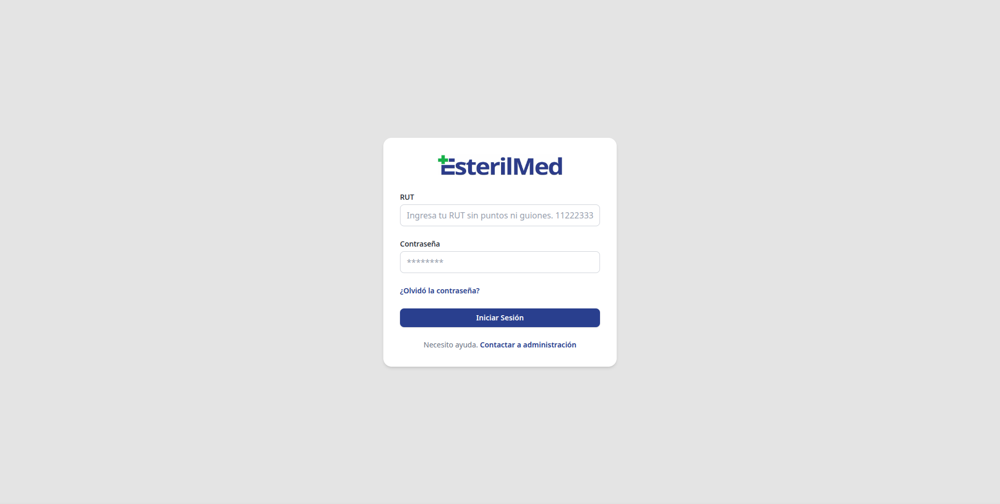
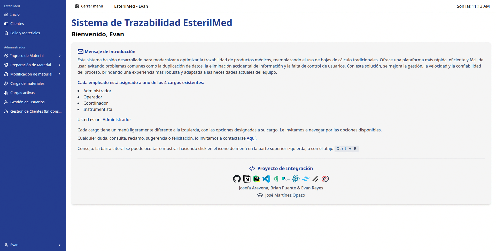
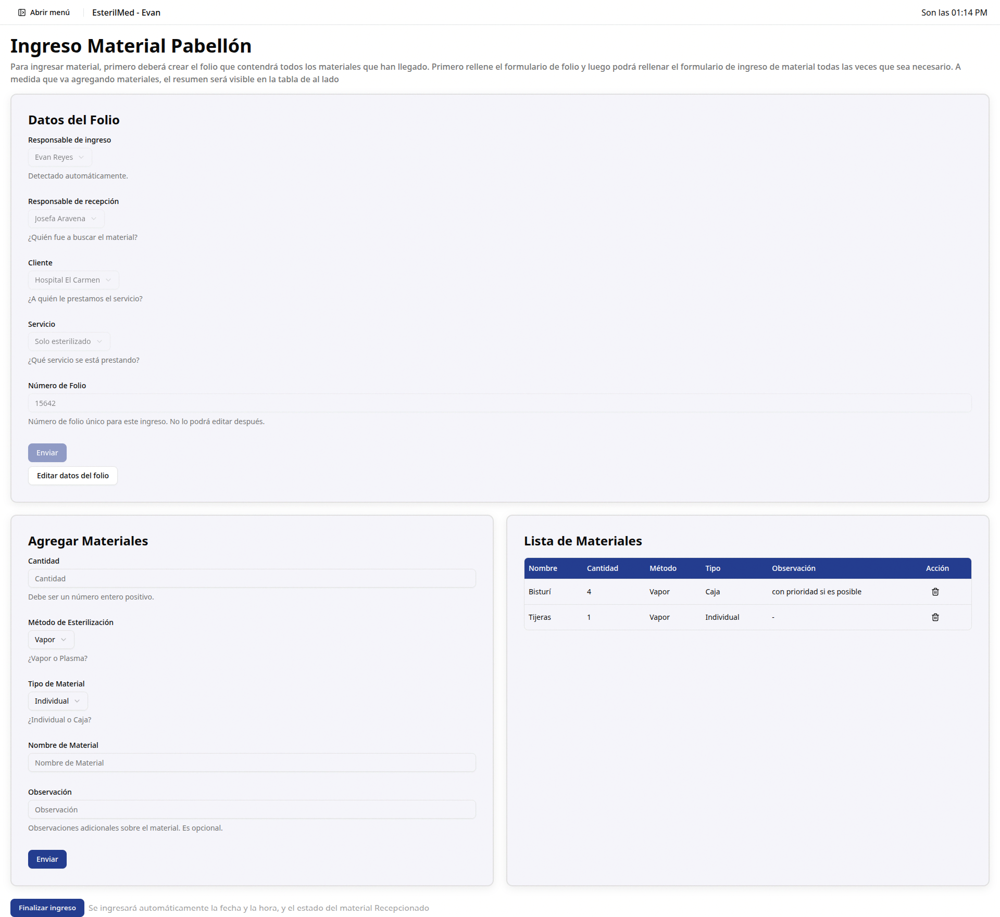
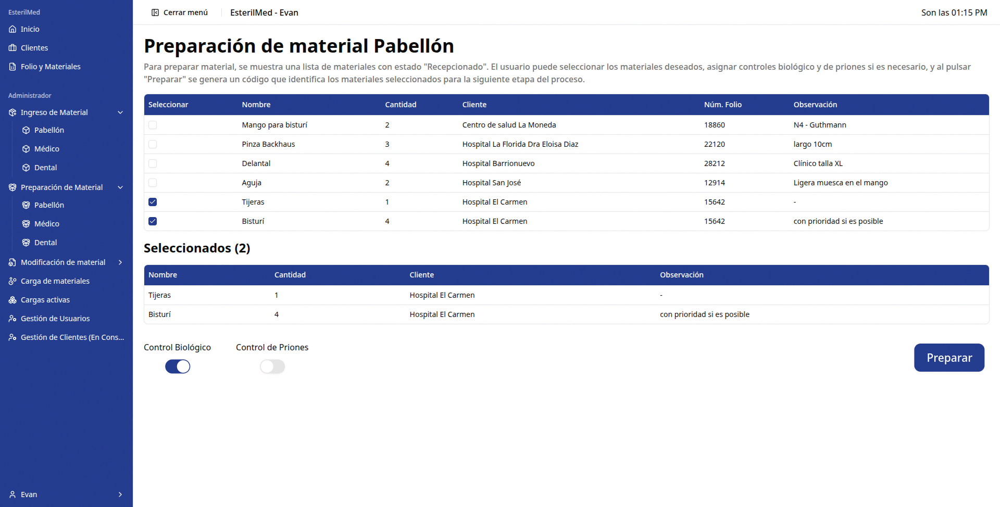
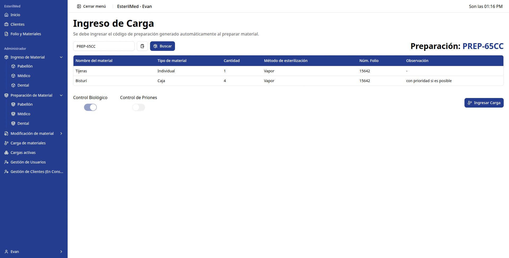
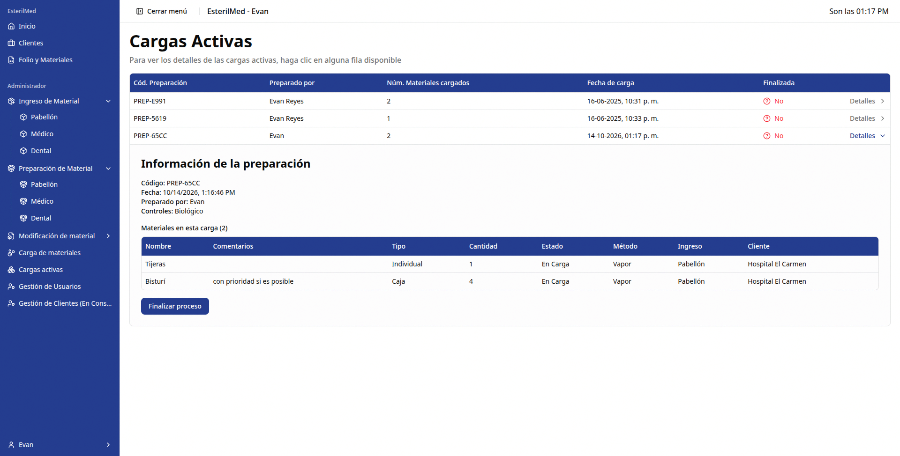
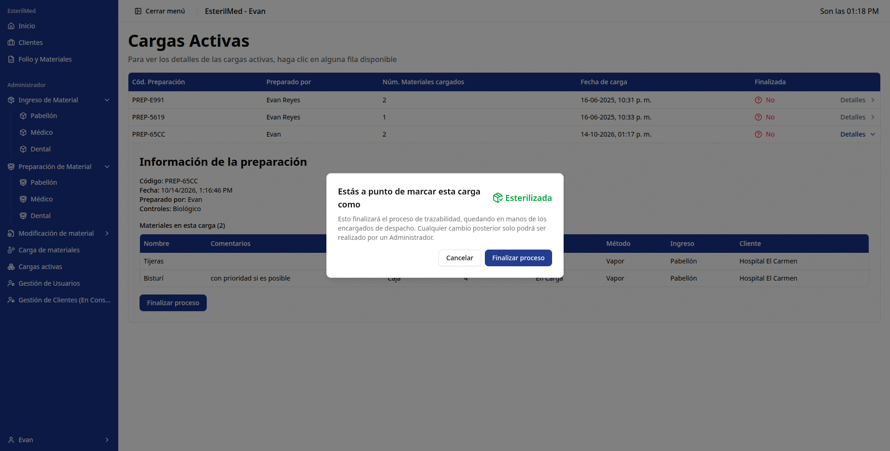
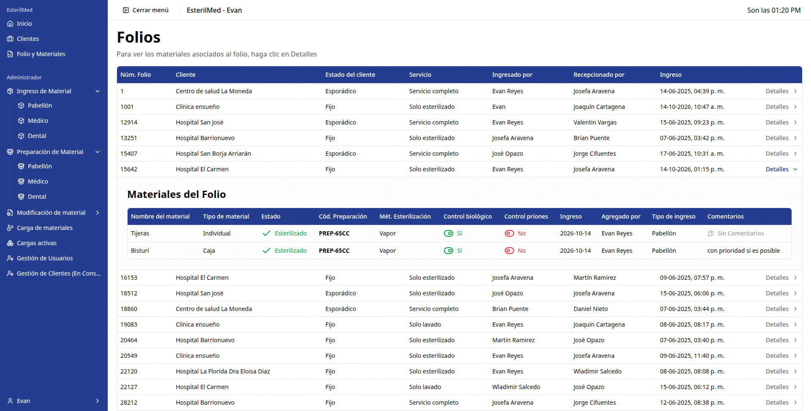

# EsterilMed — Sistema de Trazabilidad para Esterilización de Instrumental Médico

Una aplicación web que reemplaza las planillas de Excel para gestionar todo el ciclo de esterilización de instrumental médico, desde que llega de un hospital hasta que sale esterilizado y listo para volver.

**Stack:** Django REST Framework (backend) + React + Vite + Tailwind (frontend) + SQLite

---

## ¿Por qué existe este proyecto?

Hay empresas cuyo trabajo es invisible pero crítico: reciben instrumental quirúrgico usado desde hospitales y clínicas, lo lavan, preparan, esterilizan en autoclaves (grandes cámaras de vapor a presión) y lo devuelven listo para la próxima cirugía.

Si se pierde un bisturí, se mezcla una caja o no se sabe en qué estado está un material, las consecuencias son graves.

Esta empresa hacía todo ese seguimiento **en Excel**: Lento, datos duplicados, filas borradas por accidente, sin control preciso de quién editó qué, y sin forma de saber en tiempo real dónde está cada material.

**Este proyecto nace para resolver eso**: Un sistema con usuarios, roles, folios y estados que permite trazar cada instrumento paso a paso, sin perder información.

> Responde a una sola pregunta, en todo momento: **¿dónde está cada material y en qué etapa del proceso va?**

---

## El recorrido de un instrumento: así funciona el sistema

Sigamos un ejemplo real simulado: el **Hospital El Carmen** envía tijeras y bisturíes para esterilizar.

Todo empieza con un inicio de sesión simple, con RUT y contraseña. Cada trabajador tiene su rol (Administrador, Coordinador, Operador, Instrumentista) y solo ve lo que le corresponde.



Al entrar, el sistema recibe al usuario y explica qué puede hacer según su cargo. Nada de menús confusos heredados de una planilla gigante.



### 1. Ingreso: "llegó material del hospital"

El operario crea un **folio** — algo así como una ficha de ingreso — con quién lo ingresó, quién lo fue a buscar, qué cliente es (ej. Hospital El Carmen) y qué servicio pidió.

Luego agrega los materiales uno por uno: nombre, cantidad, método (Vapor o Plasma), tipo (Individual o Caja) y observaciones. Se puede hacer todo desde el teclado, sin tocar un mouse.



> Sin folio no hay proceso. Es el punto de partida que amarra todos los materiales que llegaron juntos.

### 2. Preparación: "juntar lo que se esterilizará junto"

En esta etapa se filtran los materiales que están en estado `Recepcionado` y se seleccionan los que irán juntos al autoclave.

El usuario marca tijeras y bisturí del folio 15642, activa si llevan **Control Biológico** o **Control de Priones**, y pulsa *Preparar*. El sistema genera automáticamente un código como `PREP-65CC` que identifica ese lote.



> Este código es clave: es lo que conecta el ingreso con la carga al autoclave.

### 3. Carga al autoclave: "esto entra a esterilizar"

Con el código de preparación en mano, el operario lo busca en la pantalla de **Ingreso de Carga** y verifica que el contenido sea correcto antes de cargarlo físicamente al autoclave.



> Aquí no se escribe a mano qué entró a la máquina: se recupera el lote ya preparado, evitando errores de digitación.

### 4. Seguimiento y cierre: "¿ya salió esterilizado?"

En **Cargas Activas** se ven todas las cargas que están dentro del proceso, con quién las preparó, cuántos materiales tienen y cuándo entraron.

Al abrir el detalle se puede revisar cada material y, cuando el ciclo de esterilización termina, pulsar *Finalizar proceso*.



El sistema pide confirmación antes de cerrar, porque marcar como `Esterilizada` es irreversible para un operario normal (solo un Administrador podría revertirlo).



### 5. Trazabilidad total: "quiero ver la historia del folio 15642"

Finalmente, en **Folios** está el libro mayor del sistema: cada ingreso con su cliente, servicio, responsables y fecha.

Al desplegar un folio se ve el estado final de cada material: `Esterilizado`, su código de preparación, método, controles y comentarios.



> Si un hospital llama preguntando por su material, la respuesta está a un clic.

---

*   **Problema real, cliente real:** digitaliza un proceso manual crítico para la salud.
*   **Flujo completo, no un CRUD suelto:** ingreso → preparación → carga → finalización → consulta histórica, con reglas de estado entre etapas.
*   **Roles y seguridad:** login con RUT + JWT, menús y rutas protegidas por rol (Administrador / Coordinador / Operador / Instrumentista).
*   **Trazabilidad de verdad:** folios únicos, códigos de preparación, historial de modificaciones y controles de calidad (biológico / priones).
*   **UX pensada para operarios:** formularios guiados, tablas con filtros, confirmaciones antes de acciones irreversibles.

## Tecnologías

| Capa | Herramientas |
|------|--------------|
| Backend | Python 3.12, Django 5.2, Django REST Framework, SimpleJWT, django-filter |
| Frontend | React 19, Vite, React Router v7, Axios, React Hook Form + Zod, Tailwind CSS, Radix UI |
| Datos | SQLite en desarrollo, fixtures de ejemplo incluidos |
| Otros | Git + GitHub, control de acceso por roles |

El sistema maneja además tres líneas de ingreso (Pabellón, Médico, Dental), gestión de clientes y usuarios, y vista de folios y materiales.

---

## Instalación

Requisitos: Python 3.12, Node.js 20 y Git.

```bash
# 1. Clonar
git clone https://github.com/Elebann/trazabilidad.git
cd trazabilidad

# 2. Backend
cd backend
python -m venv venv
# Windows: venv\Scripts\activate | Linux/Mac: source venv/bin/activate
pip install -r requirements.txt
python manage.py runserver
# -> http://localhost:8000/ (API en /app/api/v1/)

# 3. Frontend (en otra terminal)
cd frontend
npm install
npm run dev
# -> http://localhost:5173/
```

> [!IMPORTANT]
> El backend necesita un archivo `.env` en `/backend` (por seguridad, aquí no se comparte).
